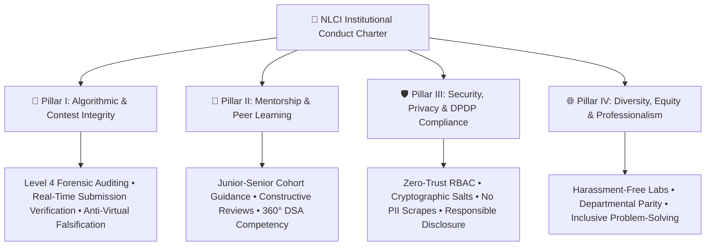
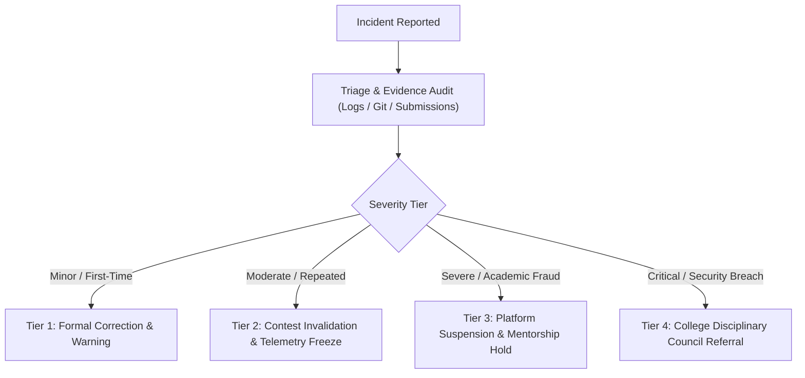

# 📜 Institutional Code of Conduct & Academic Integrity Charter

## NANDHA LEETCODE INTELLIGENCE (NLCI)
### Autonomous Institutional Contest Intelligence & Student Mentorship Platform
**Nandha Engineering College (Autonomous), Erode, Tamil Nadu, India**  
*Accredited by NAAC with 'A+' Grade • Approved by AICTE • Autonomous Institution Affiliated to Anna University*

---

### *“Fostering ethical competitive excellence, algorithmic rigor, and inclusive mentorship for 1,500+ student engineers.”*

---

## 📑 Table of Contents
1. [Executive Institutional Statement](#-executive-institutional-statement)
2. [Our Shared Community Pledge](#-our-shared-community-pledge)
3. [The Four Core Pillars of Institutional Conduct](#-the-four-core-pillars-of-institutional-conduct)
   - [Pillar I: Algorithmic & Contest Integrity](#-pillar-i-algorithmic--contest-integrity)
   - [Pillar II: Collaborative Mentorship & Peer Learning](#-pillar-ii-collaborative-mentorship--peer-learning)
   - [Pillar III: Security, Privacy & Responsible Research](#-pillar-iii-security-privacy--responsible-research)
   - [Pillar IV: Diversity, Equity & Professional Discourse](#-pillar-iv-diversity-equity--professional-discourse)
4. [Stakeholder Conduct Matrix](#-stakeholder-conduct-matrix)
5. [Enforcement Guidelines & Disciplinary Consequences](#-enforcement-guidelines--disciplinary-consequences)
6. [Confidential Incident Reporting & Whistleblower Protection](#-confidential-incident-reporting--whistleblower-protection)
7. [Governance Review & Historical Amendments](#-governance-review--historical-amendments)

---

## 🏛️ Executive Institutional Statement

The **Nandha LeetCode Intelligence (NLCI)** platform is the definitive academic and placement intelligence backbone of **Nandha Engineering College (Autonomous)**. The system governs verified contest analytics, attendance tracking, ranking indices, and institutional accreditation records (NAAC Criteria 2 & 5, NBA Continuous Evaluation). 

Because automated telemetry feeds directly into departmental appraisals, campus placement rosters, and faculty mentorship portfolios, ethical conduct is not merely an aspiration—**it is a mandatory institutional prerequisite**. This charter establishes the benchmark for professional conduct, academic honesty, and software integrity across all project repositories, communication channels, and campus environments.

---

## 🌟 Our Shared Community Pledge

We, as students, alumni, faculty mentors, department heads, placement officers, institutional leadership, and open-source contributors of **Nandha Engineering College (Autonomous)**, pledge to cultivate an open, welcoming, diverse, inclusive, and academically rigorous environment. 

We commit to ensuring that every participant—regardless of department, cohort year, programming proficiency, socio-economic background, gender identity, ethnicity, caste, religion, personal appearance, or physical disability—is empowered to excel in competitive programming with dignity and mutual respect.

---

## ⚖️ The Four Core Pillars of Institutional Conduct

### 🎯 Pillar I: Algorithmic & Contest Integrity
Academic dishonesty in competitive programming distorts institutional rankings and harms student careers. The platform enforces **Level 4 forensic telemetry**, and participants must uphold:
* **Authentic Contest Solves:** All Sunday contest submissions (Weekly & Biweekly) must be authored and submitted live during official contest windows without unauthorized automated bots or code plagiarism.
* **No Virtual/Retroactive Falsification:** Attempting to backfill solved counts retroactively or falsify virtual contest rankings to claim official Sunday attendance is strictly prohibited.
* **Single Student Profile Mapping:** Students must register and maintain their own single public LeetCode handle. Account-sharing, proxy solving, or swapping credentials violates institutional policy.

### 🤝 Pillar II: Collaborative Mentorship & Peer Learning
Technical excellence thrives through collaborative empowerment:
* **Constructive Peer Assistance:** Encourage teammates who are struggling with difficult Dynamic Programming, Graph algorithms, or Data Structures without simply giving away complete solutions.
* **Mentorship Dedication:** Faculty Mentors and Student Coordinators (`STC`) must provide timely, constructive, and empathetic feedback to their assigned student cohorts.
* **Celebrating Authentic Progress:** Acknowledge genuine milestones—such as moving from 50 to 100 solves or earning a 50-Day Streak badge—with institutional encouragement.

### 🛡️ Pillar III: Security, Privacy & Responsible Research
The platform adheres to Zero-Trust architecture and the **Digital Personal Data Protection (DPDP) Act**:
* **Respect Student Privacy:** Never scrape, extract, or share unredacted student registration numbers, phone numbers, parent WhatsApp contact details, or passwords.
* **Responsible Vulnerability Disclosure:** Security researchers discovering potential vulnerabilities must follow [`SECURITY.md`](https://github.com/nanthishvaran17/Leetcodeurl-s/blob/main/SECURITY.md) and report privately. Public exploitation or zero-day posting is strictly forbidden.
* **No Tampering with Audit Trails:** Attempting to modify PostgreSQL immutability triggers (`trg_prevent_snapshot_mutation`), falsify HMAC-SHA256 tokens, or alter system audit logs constitutes a severe cybersecurity breach.

### 🌐 Pillar IV: Diversity, Equity & Professional Discourse
We demand the highest standards of interpersonal dignity:
* **Inclusive Language:** Use welcoming and professional language across issues, pull requests, commit messages, and discord/chat groups.
* **Zero Tolerance for Harassment:** Harassment, derogatory comments, personal attacks, trolling, microaggressions, or discriminatory mockery will be met with immediate expulsion.
* **Gender & Cohort Parity:** Ensure equitable encouragement across all collegiate departments (CSE, IT, ECE, EEE, AIDS, MECH, Civil) and batch cohorts (Years I through IV).

---

## 👥 Stakeholder Conduct Matrix

| Role | Core Responsibilities | Prohibited Conduct |
| :--- | :--- | :--- |
| **Student Solvers** | Attend live contests, practice authentically, maintain public profiles, support peers. | Plagiarism, account sharing, spoofing submissions, disrespecting mentors. |
| **Faculty Mentors** | Review weekly telemetry, identify at-risk students, provide positive intervention via Action Center. | Neglecting assigned mentees, arbitrary mark penalties, sharing student contact lists. |
| **Department HODs** | Oversee departmental parity, balance faculty workload, verify accreditation workbooks. | Overriding forensic contest disqualifications without audit council approval. |
| **Placement Officers (`PLC`)** | Utilize HR Candidate Finder ethically for campus recruitment drives, verify genuine milestones. | Biased candidate shortlisting, leaking candidate evaluation dossiers to unverified vendors. |
| **Open-Source Contributors** | Follow PEP 8 & TypeScript strict standards, run 5-step test suites, respect maintainers. | Committing unverified binaries, injecting undocumented backdoors, rude PR comments. |

---

## ⚖️ Enforcement Guidelines & Disciplinary Consequences

Violations of this charter will be investigated impartially by the **Institutional Engineering Directorate** and **Departmental Disciplinary Committee**:

### 1. Tier 1: Formal Correction & Written Warning
* **Trigger:** First-time minor infraction (e.g. inappropriate PR comment, minor profile mapping mistake).
* **Action:** Private corrective counsel from Lead Maintainer or Faculty Advisor with documented resolution expectations.

### 2. Tier 2: Contest Invalidation & Telemetry Freeze
* **Trigger:** Deliberate virtual contest falsification, attempt to bypass telemetry checks, or unexcused contest proxying.
* **Action:** Retroactive invalidation of the specific contest score, 14-day telemetry freeze, and notification to Department HOD.

### 3. Tier 3: Platform Suspension & Mentorship Hold
* **Trigger:** Repeated academic dishonesty, harassment, or unauthorized extraction of cohort metrics.
* **Action:** 30 to 90-day revocation of administrative and student portal access; forfeiture of internal academic continuous assessment credits.

### 4. Tier 4: College Disciplinary Council Referral
* **Trigger:** Criminal cybersecurity tampering, database breach attempts, severe harassment, or systemic mark forgery.
* **Action:** Permanent ban from the GitHub repository and platform; immediate referral to the **Principal & Academic Disciplinary Council** of Nandha Engineering College for institutional disciplinary proceedings under college statutory bylaws.

---

## 📬 Confidential Incident Reporting & Whistleblower Protection

If you witness or experience violations of this Code of Conduct, report the incident immediately through our confidential, encrypted channels:

* **Lead Maintainer:**  
  **Nanthish S** ([@nanthishvaran17](https://github.com/nanthishvaran17))  
  📧 **Email:** `nanthishvaran17@gmail.com`  
  *Subject:* `[CONDUCT REPORT] Incident in Nandha LeetCode Intelligence`

* **Department Academic Oversight:**  
  **Dr. S. Prabhu**, Head of Department — CSE & Cyber Security  
  Department of Computer Science & Engineering, Nandha Engineering College (Autonomous), Erode - 638 052.

* **Private Security & Vulnerability Reporting:**  
  Submit directly via [GitHub Security Advisories](https://github.com/nanthishvaran17/Leetcodeurl-s/security/advisories/new).

> [!IMPORTANT]
> **Whistleblower Non-Retaliation Policy:** Nandha Engineering College strictly prohibits retaliation of any kind against any student or staff member who reports an academic integrity or conduct violation in good faith. Reports are handled with absolute confidentiality.

---

## 📚 Governance Review & Historical Amendments

This charter is reviewed bi-annually by the Institutional Software Architecture Board and Academic Review Committee.

* **Version 2.1 (Current):** November 2026 — Comprehensive institutional charter revision with 4-Tier enforcement matrix, Placement Coordinator (`PLC`) and Student Coordinator (`STC`) standards, and Level 4 contest telemetry forensic alignment.
* **Version 2.0:** October 2026 — Integration of Contributor Covenant 2.1 with DPDP Act 2023 compliance.
* **Version 1.0:** September 2026 — Initial institutional open-source code of conduct.

---

**Lead Platform Architect & Maintainer:**  
**Nanthish S** ([@nanthishvaran17](https://github.com/nanthishvaran17))  
Department of Computer Science & Engineering  
**Nandha Engineering College (Autonomous), Erode, Tamil Nadu, India**

*Accredited by NAAC with 'A+' Grade • Approved by AICTE • Autonomous Institution Affiliated to Anna University*

