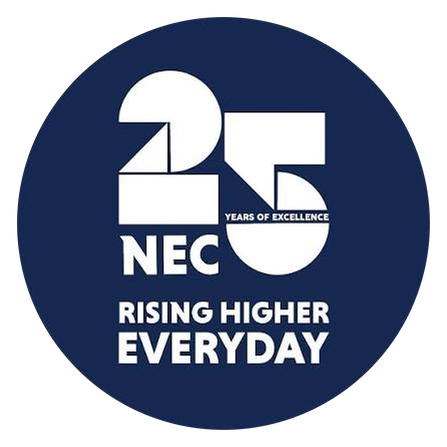

# 📜 Contributor Covenant Code of Conduct

### Nandha Engineering College (Autonomous) • LeetCode Intelligence Platform
*Accredited by NAAC with 'A+' Grade • Approved by AICTE • Autonomous Institution Affiliated to Anna University*

## 🌟 Our Pledge

We as members, contributors, institutional leaders, faculty mentors, and student engineers of **Nandha Engineering College (Autonomous)** pledge to make participation in the **Nandha LeetCode Intelligence (NLCI)** community a harassment-free, intellectually rigorous, and universally welcoming experience for everyone, regardless of age, body size, visible or invisible disability, ethnicity, sex characteristics, gender identity and expression, level of engineering experience, education, socio-economic status, nationality, personal appearance, race, caste, religion, or sexual identity and orientation.

We pledge to act and interact in ways that contribute to an open, welcoming, diverse, inclusive, and healthy institutional engineering culture.

---

## 🎯 Our Standards

### Positive Behavior That Cultivates Institutional Excellence:
* **Academic & Engineering Integrity:** Demonstrating honesty in algorithm design, respecting verified contest telemetry, and adhering to Level 4 forensic standards.
* **Empathy & Mentorship:** Supporting peer students in code problem solving, offering constructive reviews, and mentoring junior cohorts.
* **Professional Communication:** Using welcoming, inclusive language in pull requests, commit messages, code comments, and issue discussions.
* **Grace Under Feedback:** Gracefully accepting constructive technical critiques and prioritizing platform security and student privacy above ego.
* **Community Responsibility:** Prioritizing the collective academic success and placement outcomes of Nandha Engineering College students.

### Unacceptable Behavior:
* **Academic Dishonesty & Fraud:** Injecting fake contest telemetry, bypassing forensic checks, forging attendance, or falsifying LeetCode solve records.
* **Security & Privacy Breaches:** Tampering with authentication mechanisms, leaking student passwords/PII, or publishing zero-day vulnerabilities publicly without coordinated disclosure.
* **Harassment & Intimidation:** Trolling, insulting or derogatory comments, personal or political attacks, and microaggressions.
* **Inappropriate Content:** Publishing sexualized language, imagery, or inappropriate personal solicitations.
* **Unauthorized Disclosure:** Disclosing private institutional communications, confidential student grades, or unredacted audit trails.

---

## 🏛️ Institutional Scope & Enforcement

This Code of Conduct applies within all official project spaces, including the GitHub repository (`nanthishvaran17/Leetcodeurl-s`), GitHub Discussions, issue trackers, pull requests, institutional WhatsApp/email telemetry channels, campus laboratory workstations, and wherever an individual officially represents the **Nandha LeetCode Intelligence** platform.

### Reporting an Incident
Instances of abusive, harassing, or unethical behavior may be reported directly to institutional leadership:
* **Lead Maintainer:** Nanthish S ([@nanthishvaran17](https://github.com/nanthishvaran17)) — `nanthishvaran17@gmail.com`
* **Department Oversight:** Department of Computer Science & Engineering, Nandha Engineering College (Autonomous), Erode - 638 052.

All reports will be reviewed promptly, confidentially, and impartially.

### Enforcement Guidelines
1. **Correction:** Private written warning providing clarity around the violation and expected corrective action.
2. **Warning:** Formal warning with consequences for continued unacceptable behavior.
3. **Temporary Suspension:** Temporary ban from submitting PRs, commenting on issues, or accessing administrative portals.
4. **Permanent Expulsion:** Permanent ban from the project repository and referral to the College Academic Disciplinary Committee if academic fraud or cyber violation is verified.

---

## 📚 Attribution

This Code of Conduct is adapted from the [Contributor Covenant](https://www.contributor-covenant.org), version 2.1, with institutional academic governance rules tailored for **Nandha Engineering College (Autonomous)**.
