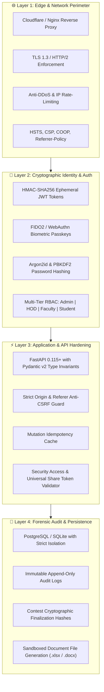

# 🛡️ Institutional Security Policy & Zero-Trust Governance

> **Nandha Engineering College (Autonomous)**  
> **Autonomous LeetCode Intelligence & Forensic Telemetry Platform**  
> *Certified for Continuous Institutional Governance & Academic Integrity*

---

---

## 📑 Table of Contents
1. [🌟 Executive Statement](#-executive-statement)
2. [🏗️ Defense-in-Depth Architectural Model](#️-defense-in-depth-architectural-model)
3. [📋 Supported Versions & Patch Lifecycle](#-supported-versions--patch-lifecycle)
4. [🎯 Vulnerability Classification & Response SLA](#-vulnerability-classification--response-sla)
5. [📬 Reporting a Vulnerability (Coordinated Disclosure)](#-reporting-a-vulnerability-coordinated-disclosure)
6. [🔬 Scope & Permitted Security Research](#-scope--permitted-security-research)
7. [🏛️ Student PII & Academic Data Compliance](#️-student-pii--academic-data-compliance)
8. [🏆 Security Hall of Fame & Acknowledgements](#-security-hall-of-fame--acknowledgements)

---

## 🌟 Executive Statement

The **Nandha LeetCode Intelligence Platform** serves as the central academic analytics, autonomous contest monitoring, and placement intelligence engine for Nandha Engineering College (Autonomous). Because the platform manages institutional student credentials, real-time Sunday contest telemetry, attendance logs, and accreditation records (NBA/NAAC), we maintain an unyielding commitment to software security, cryptographic data integrity, and responsible vulnerability disclosure.

Our infrastructure adheres to **Zero-Trust principles**: every internal and external API invocation is authenticated, authorization is verified at the database and application boundary, and all institutional reports are cryptographically signed with short-lived HMAC-SHA256 tokens.

---

## 🏗️ Defense-in-Depth Architectural Model

---

## 📋 Supported Versions & Patch Lifecycle

We actively maintain and provide regular security patches for production releases. Security updates are deployed with **zero-downtime hotfixes** to our live cloud infrastructure.

| Ecosystem Component | Supported Branch / Build | Current Production Version | Security Patch SLA | Status |
| :--- | :--- | :--- | :--- | :---: |
| **Web Application** | `main` | **v3.2.2** | Immediate (< 12h for Critical) | 🟢 **Active Support** |
| **Android Native App (.APK)** | `releases/android` | **v3.2.2 (VersionCode 62)** | Same-Day Signed Re-release | 🟢 **Active Support** |
| **Desktop Client (.EXE)** | `releases/windows` | **v3.2.0** | Next Maintenance Window | 🟡 **Supported** |
| **FastAPI Core Engine** | `backend/` | **v3.2.2** | Continuous Live Hotfix | 🟢 **Active Support** |
| **Historical Releases** | Tags `< v3.1.0` | Legacy Builds | End-of-Life | 🔴 **Unsupported** |

> [!IMPORTANT]
> Institutional staff, department coordinators, and student devices must keep their Android mobile application updated to **v3.2.2 or newer** to receive active cryptographic protection, authenticated report sharing, and passkey biometric enrollment.

---

## 🎯 Vulnerability Classification & Response SLA

We assess reported vulnerabilities according to the **Common Vulnerability Scoring System (CVSS v3.1)**:

| Severity Tier | CVSS Score Range | Examples | Response & Acknowledgment | Remediation Hotfix SLA |
| :---: | :---: | :--- | :---: | :---: |
| 🔴 **Critical (P0)** | `9.0 – 10.0` | Remote Code Execution (RCE), Authentication Bypass, SQL Injection, Unauthenticated Student Database Dump | **< 2 Hours** | **< 12 Hours** |
| 🟠 **High (P1)** | `7.0 – 8.9` | Privilege Escalation (Student -> HOD), IDOR affecting student personal records, RLS Bypass, SSRF | **< 6 Hours** | **< 24 Hours** |
| 🟡 **Medium (P2)** | `4.0 – 6.9` | Sensitive Header Exposure, Localized Rate-Limit Bypasses, CSRF on non-critical endpoints, Information Leakage | **< 12 Hours** | **< 48 Hours** |
| 🟢 **Low (P3)** | `0.1 – 3.9` | Minor information disclosure, missing verbose security banners, UI clickjacking without demonstrated impact | **< 24 Hours** | Next Sprint Release |

---

## 📬 Reporting a Vulnerability (Coordinated Disclosure)

If you discover a potential vulnerability within the Nandha LeetCode Intelligence platform, **please do not publish or disclose it publicly** (e.g., via GitHub Issues, public Discord channels, or social media).

### 🛡️ Private Reporting Channels:
1. **GitHub Private Security Advisory:**  
   Navigate to the repository's **[Security Tab > Report a Vulnerability](https://github.com/nanthishvaran17/Leetcodeurl-s/security/advisories/new)** to submit a private, encrypted advisory directly to the core developers.
2. **Direct Security Contact:**  
   Send an encrypted email directly to the Institutional Platform Maintainer:  
   📧 **`nanthishvaran17@gmail.com`** 
   *Subject line:* `[SECURITY REPORT] Potential Vulnerability in Nandha LeetCode Tracker`

### 📝 What to Include in Your Report:
To help us triage and remediate the issue rapidly, please provide:
* **Description:** A detailed explanation of the vulnerability and its potential risk.
* **Component Affected:** Target API endpoint, Web URL route, Android APK activity, or backend module.
* **Reproduction Steps:** Step-by-step instructions or cURL commands to reproduce the behavior.
* **Proof-of-Concept:** Screenshots, HTTP request/response transcripts, or sanitized PoC scripts.
* **Suggested Fix / Remediation:** If you have insights into remediation (e.g. input sanitization, policy constraint), feel free to include it.

> [!CAUTION]
> Under no circumstances should you extract, download, modify, or retain sensitive student PII, institutional passwords, internal API keys, or grading rubrics during your security research.

---

## 🔬 Scope & Permitted Security Research

### ✅ In-Scope Assets
* Production API endpoints hosted under `https://nandha-leetcode.duckdns.org/api/`
* Client application single-page interface: `https://nandha-leetcode.duckdns.org`
* Android application codebase and native plugins (`org.nandhaengg.leetcodesync`)
* Session management, JWT verification, and FIDO2 passkey flows
* Sunday Contest report verification and authenticated universal sharing tokens

### ❌ Out-of-Scope (Strictly Prohibited)
* Denial of Service (DoS / DDoS) attacks aimed at degrading availability for students or faculty
* Physical attacks against institutional infrastructure or college laboratory workstations
* Social engineering, phishing, or vishing targeting college staff, HODs, or students
* Spamming automated emails or WhatsApp SMS notifications
* Direct attacks against third-party upstream platforms (e.g., LeetCode GraphQL APIs, Firebase, Cloudflare, DuckDNS)

---

## 🏛️ Student PII & Academic Data Compliance

The Nandha LeetCode Intelligence platform is engineered to comply with institutional academic governance, FERPA privacy standards, and the **Digital Personal Data Protection (DPDP) Act**:

* **Minimal Data Principle:** The system stores only academic-relevant identifiers (Register Number, Name, Department, Year, LeetCode Public Handle, and Contest Performance).
* **Cryptographic Salt & Hash:** Student and faculty passwords are encrypted using multi-round salted PBKDF2/Argon2. Plaintext passwords never enter the persistence layer.
* **Session Bound Security:** Ephemeral JWT access tokens have strict expiration policies. Refresh tokens are bound to device footprints and can be revoked globally by administrators with a single tap.
* **Audit Trail Immutability:** All administrative actions (student roster imports, mark adjustments, contest overrides) generate immutable audit logs recorded with timestamps and operator credentials.

---

## 🏆 Security Hall of Fame & Acknowledgements

We deeply appreciate and value security researchers and institutional students who dedicate their time to discovering and reporting vulnerabilities responsibly.

Researchers who submit valid, actionable, and previously unknown vulnerabilities will receive:
* Official written commendation and Certificate of Appreciation from the **Department of Computer Science & Engineering, Nandha Engineering College (Autonomous)**.
* Permanent attribution in our **Institutional Security Hall of Fame**.
* Formal recommendation letter for career development and cybersecurity credentials upon request.

---

> [!NOTE]
> *Nandha Engineering College (Autonomous) reserves the right to amend this Security Policy at any time. All updates are committed directly to this repository.*  
> **Last Verified & Audited:** October 2026 • Platform Version 3.2.2
