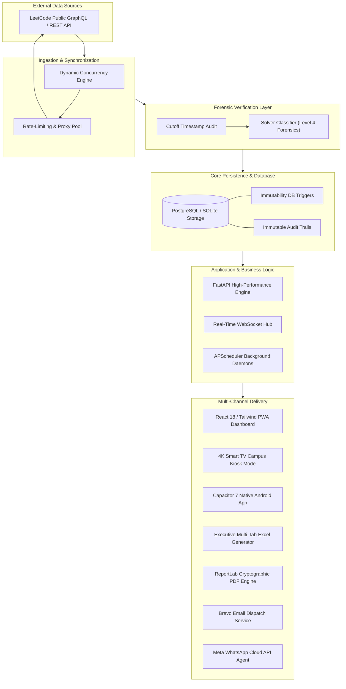

<div align="center">


# 🟢 NANDHA LEETCODE TRACKER & CONTEST INTELLIGENCE
### Official LeetCode Tracker for Nandha Engineering College • Autonomous Institutional Contest Intelligence • Forensic Verification Platform

**Nandha Engineering College (Autonomous), Erode, Tamil Nadu, India**
*Accredited by NAAC with 'A+' Grade • Approved by AICTE • Autonomous Institution Affiliated to Anna University*

<p align="center">
  <a href="http://13.53.231.6"></a>
  <a href="https://github.com/nanthishvaran17/Leetcodeurl-s/releases/latest"></a>
  <a href="docs/ARCHITECTURE.md"></a>
  <a href="https://github.com/nanthishvaran17/Leetcodeurl-s/releases"></a>
</p>

<p align="center">
  <a href="https://github.com/nanthishvaran17/Leetcodeurl-s"></a>
  <a href="https://github.com/nanthishvaran17/Leetcodeurl-s"></a>
  <a href="https://github.com/nanthishvaran17/Leetcodeurl-s"></a>
  <a href="https://github.com/nanthishvaran17/Leetcodeurl-s"></a>
  <a href="https://github.com/nanthishvaran17/Leetcodeurl-s"></a>
</p>

<p align="center">
  
  
  
  
  
  
  
  
</p>

### *Track every contest. Forensically verify every record. Empower 1,500+ student careers.*

</div>

---

## 🧭 Navigation & Architecture Directory

<div align="center">

| Section | Description | Status |
|:---|:---|:---:|
| [🌟 Executive Overview](#-executive-overview) | Institutional analytics paradigm & collegiate scale | `Enterprise Ready` |
| [📸 Live Production Showcase](#-live-production-showcase) | 4K Dashboard, 360° Radar, Compare Arena & HR Studio | `Interactive UI` |
| [⚡ Sunday Contest Autopilot](#-autonomous-sunday-contest-engine) | 4-phase hands-free contest telemetry pipeline | `100% Autonomous` |
| [🔬 Level 4 Forensic Verification](#-level-4-forensic-verification) | Strict Q1-Q4 binary solve timestamps & tamper audit | `Forensic Proof` |
| [🏛️ HOD Command Center](#️-hod-command-center--governance) | Department isolation & faculty mentoring matrix | `Governance` |
| [🎯 360° DSA Competency Radar](#-360-radar--student-analytics) | Skill radar, progression curves, submission heatmaps | `Analytics` |
| [⚔️ Head-to-Head Compare Arena](#-head-to-head-compare-arena) | Direct peer-to-peer benchmarking & solve differentials | `Live Arena` |
| [💼 HR Placement Intelligence](#-hr-placement-intelligence-finder) | Placement recruitment filters & candidate spotlight | `Talent Discovery` |
| [💎 Emerald Vault & Smart ID Pass](#-emerald-vault--smart-id-pass) | 25-Year Celebration PVC Smart ID & Hall of Fame | `Physical + Digital` |
| [🎓 NAAC & NBA Accreditation Studio](#-naac--nba-accreditation-studio) | Criteria 2 & 5 automated quantitative dossiers | `NBA / NAAC Ready` |
| [📊 Multi-Channel Automated Dispatch](#-automated-reporting--brevo-email) | Excel Workbooks, Cryptographic PDFs, Brevo & WhatsApp | `Automated` |
| [🏗️ System Architecture](#️-system-architecture) | End-to-end telemetry flowchart & pipeline model | `Microservices` |
| [📘 Developer Architecture Guide](docs/ARCHITECTURE.md) | Deep technical architecture documentation | `Technical Docs` |
| [🛡️ Evidence-First Integrity Model](#️-evidence-first-integrity-model) | Strict "never guess missing data" philosophy | `Zero Falsehood` |
| [💻 Production Technology Stack](#-technology-stack) | FastAPI, React 18, PostgreSQL, Capacitor 7, Vite | `Modern Stack` |
| [🚀 Quick Start & Deployment Guide](#-quick-start--deployment-guide) | Local development, Docker & AWS production deploy | `One-Click Run` |
| [👥 Institutional Leadership](#-institutional-leadership) | Engineering faculty, college administration & contributors | `Nandha Engg` |

</div>

---

## 🌟 Executive Overview

**Nandha LeetCode Intelligence** is a mission-critical, enterprise-grade academic analytics and contest forensics platform engineered exclusively for **Nandha Engineering College**. It transforms chaotic, unverified competitive-programming activity from LeetCode into structured, tamper-proof, and actionable institutional intelligence.

Traditional tracking scripts rely on brittle web-scraping that fails during high concurrency, falsely treats temporary API timeouts as non-participation, and cannot distinguish live contest solves from post-contest virtual submissions. 

**Nandha LeetCode Intelligence solves this with an authoritative, evidence-first engineering paradigm:**

```text
LeetCode Raw Signals
        ↓
Controlled Dynamic Concurrency Pipeline (1,500+ Students)
        ↓
Level 4 Forensic Timing & Solve Verification (Q1 / Q2 / Q3 / Q4)
        ↓
Canonical Persistence with Database Snapshot Immutability Triggers
        ↓
Multi-Dimensional Analytics: Spider Skill Competencies & Trajectory Growth
        ↓
Executive Governance: HOD Matrix, Faculty Intervention Queue, Placement Intelligence
        ↓
Automated Multi-Channel Dispatch: WhatsApp Cloud API, Brevo Mailer, Smart TV Kiosk, PVC Smart IDs
```

### 🏛️ Institutional Scale at a Glance

| Metric | Verified Production Value | Description |
|---|---|---|
| **Tracked Student Body** | **1,500+ Active Students** | Real-time tracking across 8 engineering departments & 4 year tiers |
| **Weekly Contests Tracked** | **52+ Annual Contests** | Complete historical weekly and biweekly contest timeline |
| **Sunday Autopilot Concurrency** | **4-Phase Autonomous Pipeline** | Zero human intervention needed from 08:00 AM IST to report generation |
| **Verification Depth** | **Level 4A / 4B / 4C Forensics** | Timestamp audit against LeetCode contest cutoff to block virtual falsification |
| **Institutional Exporters** | **Excel, PDF, Email & WhatsApp** | Boardroom-ready automated weekly packages with embedded crests |
| **Accreditation Readiness** | **NBA Criteria 2 & 5 / NAAC** | Quantitative metrics formatted directly for national accreditation audits |

---

## 📸 Live Production Showcase

<div align="center">

### 1. 🖥️ Executive Analytics Command Center
*Real-time student leaderboard, multi-metric KPI tracking, live sync progress engine, and podium recognition.*


---

### 2. 🔬 360° Spider Competency & Student Forensic Profile
*Multi-axis Data Structures & Algorithms (DSA) competency radar, contest rating progression curves, and submission heatmaps.*


---

### 3. ⚔️ Real-Time Head-to-Head Compare Arena
*Direct peer-to-peer benchmarking across LeetCode ratings, global ranks, solved tiers (Easy/Medium/Hard), and topic proficiencies.*


---

### 4. 💼 Campus Placement & HR Candidate Intelligence Finder
*Dedicated recruiter studio to filter high-performing candidates by specific rating thresholds, streak records, and problem mastery.*


</div>

---

## ⚡ Autonomous Sunday Contest Engine

Every Sunday from **08:00 AM IST to 12:00 PM IST**, the platform shifts into full autopilot mode via GitHub Actions and local multi-worker daemons:

```text
┌────────────────────────────────────────────────────────────────────────────────────────┐
│                        SUNDAY CONTEST AUTOPILOT PIPELINE                               │
├─────────────────────┬────────────────────┬─────────────────────┬───────────────────────┤
│ PHASE 1: DISCOVERY  │ PHASE 2: LIVE SYNC │ PHASE 3: FORENSICS  │ PHASE 4: DISPATCH     │
│ 08:00 AM IST        │ 08:00 - 09:30 AM   │ 09:30 - 10:15 AM    │ 10:30 AM IST          │
├─────────────────────┼────────────────────┼─────────────────────┼───────────────────────┤
│ • Auto-detects URL  │ • Streaming polls  │ • Timestamp audit   │ • Generates Excel/PDF │
│ • Identifies Q1-Q4  │   1,500+ profiles  │ • Separates virtual │ • Brevo Mailer to HODs│
│ • Initializes locked│ • High-resilience  │   from live solves  │ • WhatsApp alerts to  │
│   snapshot session  │   retry pool       │ • Level 4 audit log │   students & parents  │
└─────────────────────┴────────────────────┴─────────────────────┴───────────────────────┘
```

* **Friday Official Resync Engine (05:00 AM IST):** LeetCode officially publishes final rating updates and global ranks on Friday mornings. The platform executes an automated resync pipeline that validates dispute reconciliations without mutating finalized historical snapshot records.

---

## 🔬 Level 4 Forensic Verification

In institutional competitive programming, data accuracy is paramount. A common failure in simple scrapers is crediting students who solved contest problems *after* the contest ended (Virtual Contests / Practice mode).

**The Forensic Verification Rulebook:**
1. **Contest Cutoff Window Validation:** Every submission's Unix timestamp must fall between `ContestStart` and `ContestEnd` (08:00:00 to 09:30:00 IST).
2. **Authoritative Hash Immutability:** Once a weekly snapshot is signed and sealed, SQL database triggers (`trg_prevent_snapshot_mutation`) strictly reject direct in-place mutation. Revisions must use `snapshot_supersedes()`.
3. **Evidence-First Classification:**
   * `AUTHENTIC_SOLVER`: Solved within the strict contest window with verifiable submission ID.
   * `POST_CONTEST_PRACTICE`: Solved after contest window; credited to general practice, excluded from contest rating.
   * `NOT_ATTENDED`: Verified absence; distinct from network timeouts or API failure.

---

## 🏛️ HOD Command Center & Governance

The platform provides dedicated, isolated administrative tools tailored for academic department heads:

* **Departmental Isolation:** Clean boundary isolation for Computer Science (CSE), Information Technology (IT), Electronics & Communication (ECE), Electrical & Electronics (EEE), Artificial Intelligence & Data Science (AI&DS), and Computer Science & Business Systems (CSBS).
* **Workload Optimization Matrix:** Eliminates the classic "30-mentee bottleneck" by dynamically distributing students among faculty mentors with automated performance tracking.
* **Faculty Action Queue:** Automated flagging for students showing sudden contest drops, inactive streaks, or rating plateaus, with action logs for compliance and internal audits.

---

## 💎 Emerald Vault & Smart ID Pass

The **Emerald Vault** is a high-visibility student recognition portal that celebrates verifiable programming milestones:

* **Official 25-Year Celebration PVC Smart ID Card:** Generates high-density student coding passes featuring:
  * Embedded high-contrast college seal & 25-Year Celebration insignia
  * Dynamic student LeetCode global rank & contest rating tier
  * Cryptographic QR Code that links directly to `/verify/:id` for public validation by interviewers and employers
* **Hall of Fame Tiers:**
  * 🥇 *Contest Champion* (Rating 1800+ / Knight & Guardian level)
  * 🥈 *Century Club* (100+ Contests Attended)
  * 🥉 *Streak Master* (Continuous 12+ Weeks Live Participation)
  * ⚡ *DSA Specialist* (Hard Problem Solve Specialist)

---

## 🎓 NAAC & NBA Accreditation Studio

Higher education regulatory bodies (NBA Criteria 2 & 5, NAAC, NIRF) require verifiable quantitative evidence of student programming skills, technical competitions, and continuous evaluation:

* **One-Click Audit Dossier:** Generates comprehensive PDF/Excel dossiers detailing student participation rates, batch-wise performance trends, and institutional contest rankings.
* **Continuous Internal Evaluation (CIE) Data:** Directly exports LeetCode contest rankings as verifiable laboratory and continuous assessment marks.
* **Tamper-Evident Records:** Cryptographic verification IDs allow external peer-reviewers and audit teams to verify authenticity instantly on-campus.

---

## 📊 Automated Reporting & Brevo Email

Reporting is a fully automated, hands-free core workflow:

* **Multi-Tab Executive Excel Workbooks:** Built with custom OpenPyXL generators containing:
  * Master college summary with embedded official emblems
  * Department-by-department score breakdown
  * Faculty mentor distribution reports
  * Question-wise (Q1-Q4) solver matrices with conditional styling
* **Official Executive PDF Reports:** Generated using ReportLab with exact institutional typography, watermark seals, and statistical summaries.
* **Brevo API Automated Dispatch:** Delivers Sunday reports directly to Principal and HOD inboxes with idempotent delivery logs and retry backoff.
* **Meta WhatsApp Cloud API:** Sends personalized performance and rank updates to students upon contest finalization.

---

## 🏗️ System Architecture



---

## 🛡️ Evidence-First Integrity Model

### The Golden Rule of Institutional Data: *Never Guess Missing Data*

In enterprise academic systems, an erroneous mark can damage a student's career. External platform outages, private profiles, and network glitches are explicitly recognized and isolated:

```text
┌─────────────────────────┬────────────────────────────────────────────────────────┐
│ PLATFORM STATE          │ SEMANTIC INTERPRETATION                                │
├─────────────────────────┼────────────────────────────────────────────────────────┤
│ UNKNOWN                 │ ≠ 0 (Never assume 0 without confirmed proof)           │
│ PRIVATE PROFILE         │ ≠ 0 (Flagged for student profile privacy unblock)     │
│ FETCH FAILED            │ ≠ ABSENT (Network failure isolated, queued for retry)  │
│ UNAVAILABLE             │ ≠ NOT ATTENDED (Pending authoritative Sunday snapshot) │
└─────────────────────────┴────────────────────────────────────────────────────────┘
```

---

## 💻 Production Technology Stack

<table>
<tr>
<th width="33%" align="center">🎨 Frontend & Client</th>
<th width="33%" align="center">⚙️ Backend & Core Engine</th>
<th width="33%" align="center">☁️ Data & Cloud Infrastructure</th>
</tr>
<tr>
<td valign="top">

-  **React 18 & TypeScript 5.2+**
-  **Vite 5** (Ultra-fast HMR)
-  **Tailwind CSS & Design Tokens**
-  **TanStack React Query v5**
-  **Capacitor 7 Native Android App**
-  **Recharts & Lucide Icons**
-  **PWA & Offline Service Workers**
- 📱 **Native Drawers & Tactile Haptic Chimes**

</td>
<td valign="top">

-  **FastAPI High-Speed Async Core**
-  **Python 3.10+ ASGI Engine**
-  **SQLAlchemy 2.0 ORM**
-  **Real-Time WebSocket Mesh**
-  **Multi-Job Cron Daemons**
-  **Brevo Transactional Dispatch**
-  **Meta WhatsApp Cloud API Agent**
- 📄 **OpenPyXL (Excel) & ReportLab (PDF)**

</td>
<td valign="top">

-  **PostgreSQL 16 Primary Database**
-  **SQLite WAL Resilience Engine**
-  **Multi-Stage Docker Containers**
-  **Nginx SSL & WSS Proxy**
-  **AWS EC2 Ubuntu 24.04 LTS**
-  **Automated CI/CD Workflows**
- 🛡️ **Level-4 Cryptographic Audit Trail**

</td>
</tr>
</table>

---

## 🚀 Quick Start & Deployment Guide

### 1. Prerequisites
* Python 3.10 or higher
* Node.js 18.x or higher & npm
* Git

### 2. Clone the Repository
```bash
git clone https://github.com/nanthishvaran17/Leetcodeurl-s.git
cd Leetcodeurl-s
```

### 3. Backend Setup
```bash
# Create virtual environment
python -m venv venv
venv\Scripts\activate      # On Windows
source venv/bin/activate    # On Linux/macOS

# Install dependencies
pip install -r requirements.txt

# Start FastAPI Backend Server
python -m uvicorn backend.main:app --host 127.0.0.1 --port 8000 --reload
```

### 4. Frontend Setup
```bash
cd frontend

# Install Node modules
npm install

# Run frontend in development mode
npm run dev
```
Open [http://localhost:5173](http://localhost:5173) in your browser.

---

### 5. Production Startup Scripts

For one-click production launches, pre-configured scripts are located in the [scripts/](scripts/) directory:

* **FastAPI Backend (4 Workers):** Run `scripts/run_backend_prod.bat`
* **React Production Build:** Run `scripts/run_frontend_prod.bat`
* **Full Production Daemon:** Run `scripts/start_production.bat`
* **Sunday Autopilot Runner:** Run `python scripts/sunday_automation_complete.py`

---

## 👥 Institutional Leadership

<div align="center">

**Nandha Engineering College (Autonomous)**
*Established in 2001 • Celebrating 25 Years of Educational Excellence*
Erode - Perundurai Main Road, Vaikkaalmedu, Erode, Tamil Nadu 638052

**Platform Architecture & Lead Engineering:**
**Nanthish S** ([@nanthishvaran17](https://github.com/nanthishvaran17))
*Department of Computer Science and Engineering*

</div>

---

<div align="center">

### 🟢 NANDHA LEETCODE INTELLIGENCE
**1,500+ Students • 8 Departments • One Institutional Truth**

*Crafted with precision for the students and faculty of Nandha Engineering College.*

</div>
