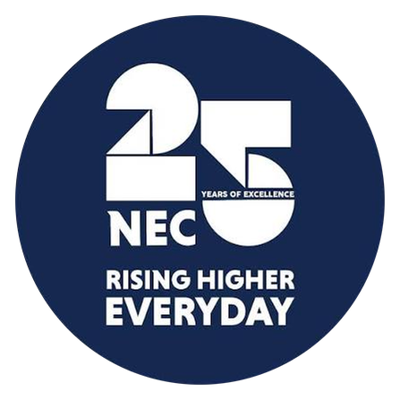
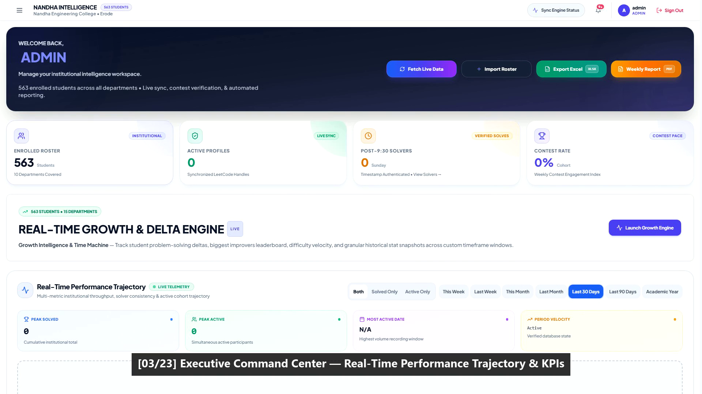
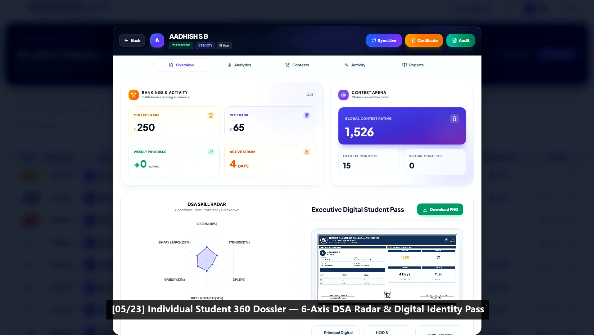
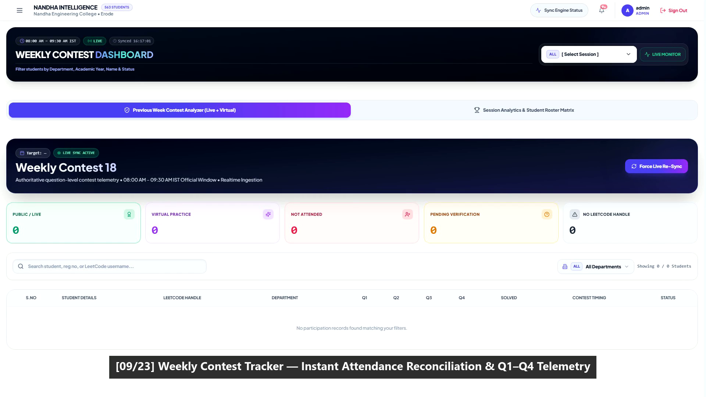
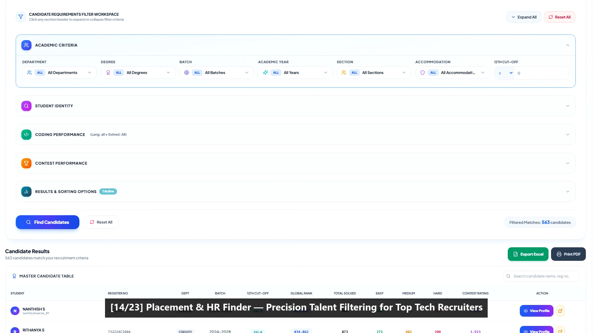
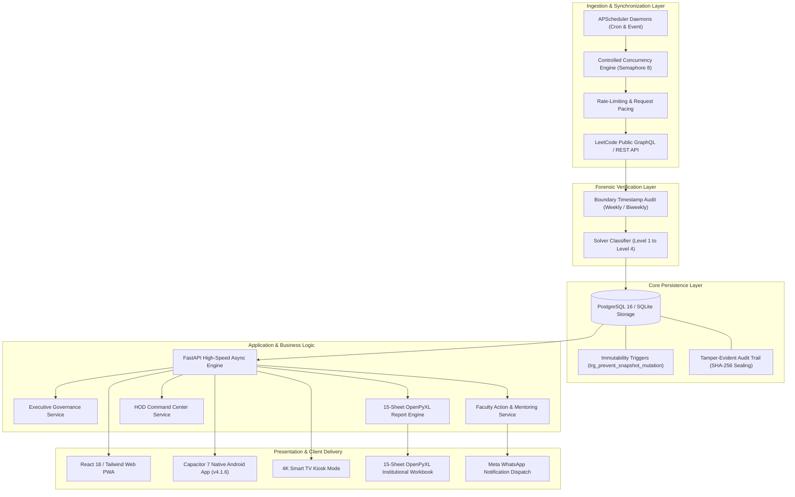

<div align="center">



# NANDHA LEETCODE INTELLIGENCE (NLCI)
### Autonomous Institutional Contest Intelligence • Level 4 Forensic Verification • Student Mentorship Platform

**Nandha Engineering College (Autonomous), Erode, Tamil Nadu, India**  
*Accredited by NAAC with 'A+' Grade • Approved by AICTE • Autonomous Institution Affiliated to Anna University*

<p align="center">
  <a href="https://nandha-leetcode.duckdns.org"></a>
  <a href="https://github.com/nanthishvaran17/Leetcodeurl-s/releases/latest"></a>
  <a href="releases/android/Nandha_LeetCode_Intelligence_v4.1.6_latest.apk"></a>
  <a href="https://github.com/nanthishvaran17/Leetcodeurl-s/blob/main/LICENSE"></a>
</p>

<p align="center">
  
  
  
  
  
  
  
</p>

### *Every contest tracked. Every solve verified. 1,500+ student engineering careers empowered.*

</div>

---

## Table of Contents
1. [Executive Overview](#executive-overview)
2. [The Collegiate Problem & Solution Architecture](#the-collegiate-problem--solution-architecture)
3. [Level 1 to Level 4 Verification Matrix](#level-1-to-level-4-verification-matrix)
4. [Weekly & Biweekly Contest Autopilot](#weekly--biweekly-contest-autopilot)
5. [Live Production Showcase](#live-production-showcase)
6. [Core System Modules](#core-system-modules)
7. [System Architecture & Data Flow](#system-architecture--data-flow)
8. [Evidence-First Integrity Protocol](#evidence-first-integrity-protocol)
9. [Production Technology Stack](#production-technology-stack)
10. [Quick Start & Local Development](#quick-start--local-development)
11. [Testing & Build Verification](#testing--build-verification)
12. [Project Structure](#project-structure)
13. [Data Privacy, Security & Ethics](#data-privacy-security--ethics)
14. [Institutional Leadership & Engineering Credits](#institutional-leadership--engineering-credits)
15. [License & Contributing](#license--contributing)

---

## Executive Overview

**Nandha LeetCode Intelligence (NLCI)** is an institutional competitive-programming analytics, contest forensics, and automated mentorship engine engineered for **Nandha Engineering College (Autonomous)**. 

Operating across **1,500+ active students** across 8 core engineering departments, NLCI replaces unverified manual spreadsheets with a deterministic, tamper-evident data pipeline. It ingests public LeetCode telemetry, verifies live contest solves against official contest windows, enforces database-level immutability triggers, and delivers actionable mentorship insights to Faculty Mentors, Heads of Departments (HODs), College Leadership, and Placement Recruiters.

> [!NOTE]
> **Database Architecture & Compatibility**:  
> • **Local Development**: Defaults to **SQLite (WAL mode)** for instant, zero-config startup and rapid prototyping out of the box.  
> • **Production Deployment**: Runs on **PostgreSQL 16** where multi-worker connection pooling, row-level locks, and snapshot immutability triggers (`trg_prevent_snapshot_mutation`) are strictly enforced.

---

## The Collegiate Problem & Solution Architecture

### The Problem in Collegiate Competitive Programming
* **Cloudflare Rate-Limiting & Scraping Failures**: Uncoordinated batch scraping of hundreds of student profiles triggers Cloudflare challenge walls and IP blocks.
* **Virtual Contest Falsification**: Naive scrapers check total solved counts or contest rank without validating solve timestamps, mistakenly awarding academic credit to post-contest virtual attempts.
* **The "Zero Solves" Hazard**: When third-party APIs encounter temporary network timeouts, traditional scripts record "0 solves", demoralizing hardworking students.
* **Mentorship Blind Spots**: Faculty mentors lack proactive early-warning signals for silent student disengagement, streak drops, and contest drop-offs.
* **Cross-Department Privacy Boundaries**: Multi-department institutions require strict data isolation so faculty mentors and HODs govern their assigned cohorts securely.

### The NLCI Engineering Solution
```text
LeetCode Public Telemetry
        ↓
Controlled-Concurrency Ingestion (Semaphore(8) + Exponential Backoff)
        ↓
Level 4 Timestamp & API Payload Verification (Disqualifies Virtual & Post-Contest Solves)
        ↓
Canonical Persistence with PostgreSQL Immutability Triggers (trg_prevent_snapshot_mutation)
        ↓
Multi-Dimensional Analytics (360° DSA Competency Radar, Contest Trajectories & Streak Monitoring)
        ↓
Role-Based Governance Portals (Management Oversight, HOD Command Center, Faculty Action Center)
        ↓
Multi-Channel Automated Dispatch (WhatsApp Alerts, Brevo Email, 15-Sheet Excel, Signed Android APK, 4K TV Kiosk)
```

---

## Level 1 to Level 4 Verification Matrix

To eliminate ambiguity, NLCI classifies every student solve through a deterministic 4-level verification hierarchy:

| Verification Level | Technical Check Name | Verification Mechanism | Institutional Guarantee |
|:---:|:---|:---|:---|
| **Level 1** | **Profile Discovery & Reachability** | Public GraphQL user profile probe | Confirms registered LeetCode handle exists and is publicly accessible. |
| **Level 2** | **Contest Attendance Verification** | `userContestRankingHistory` GraphQL query | Verifies the student officially registered and attended the scheduled contest. |
| **Level 3** | **Accepted Problem Solves Audit** | Problem slug & `Accepted` status check | Validates that submission status was `Accepted` on target problem IDs. |
| **Level 4A** | **Contest Window Timestamp Audit** | Strict boundary comparison against official contest window | Disqualifies any solve submitted outside the live contest window (Weekly: Sunday 08:00–09:30 AM IST; Biweekly: Saturday 20:00–21:30 PM IST). |
| **Level 4B** | **Live Submission ID Verification** | Payload matching with LeetCode live submission logs | Distinguishes live contest submissions from retroactive virtual contest backfilling. |
| **Level 4C** | **Snapshot Sealing & Immutability** | **SHA-256 Checksum Hashing** + Database Triggers | Contest snapshots are sealed with SHA-256 hashes. Database trigger `trg_prevent_snapshot_mutation` rejects retroactive mutations. |

> [!TIP]
> All student certificates and 25-Year Smart Passes generated by NLCI use **HMAC-SHA256 verification tokens** and verifiable QR codes linked directly to [CertificateVerificationPage](file:///frontend/src/pages/CertificateVerificationPage.tsx).

---

## Weekly & Biweekly Contest Autopilot

NLCI dynamically tracks both official LeetCode contest schedules:

```text
┌────────────────────────────────────────────────────────────────────────────────────────┐
│                        AUTONOMOUS CONTEST TIMELINE ENGINE                              │
├────────────────────────────┬───────────────────────────────────────────────────────────┤
│ CONTEST EVENT              │ OFFICIAL WINDOW (IST)                                     │
├────────────────────────────┼───────────────────────────────────────────────────────────┤
│ LeetCode Weekly Contest    │ Every Sunday: 08:00 AM – 09:30 AM IST (90 Minutes)        │
│ LeetCode Biweekly Contest  │ Alternate Saturdays: 08:00 PM – 09:30 PM IST (90 Minutes) │
└────────────────────────────┴───────────────────────────────────────────────────────────┘
```

The contest window cutoff is not hardcoded; it is dynamically resolved from official contest start and finish timestamps retrieved via the GraphQL API, ensuring that both Weekly and Biweekly contests are audited with second-level precision.

### The 4-Phase Autopilot Lifecycle:
1. **Phase 1: Pre-Contest Warmup (T-15m)**: Clears stale cache, checks proxy pool health, and snapshots pre-contest problem counts.
2. **Phase 2: Live Window Observation (T+0m to T+90m)**: Low-overhead monitoring of live participant activity.
3. **Phase 3: Deep Forensic Ingestion (T+90m to T+135m)**: Concurrently pulls per-problem solve timestamps, extracts Q1–Q4 submission IDs, and executes Level 4A/B/C verification.
4. **Phase 4: Sealed Snapshot & Dispatch (T+135m)**: Generates department rankings, seals the week's database snapshot with SHA-256 checksums, and dispatches automated 15-Sheet Excel reports to HODs and college leadership.

---

## Live Production Showcase

<div align="center">

### 1. Executive Analytics Command Center
*Real-time student leaderboard, multi-metric KPI tracking, live sync engine, and podium recognition.*



---

### 2. 360° DSA Competency & Forensic Profile
*Multi-axis Data Structures & Algorithms competency radar, contest rating progression curves, and submission heatmaps.*



---

### 3. Real-Time Head-to-Head Compare Arena
*Direct peer-to-peer benchmarking across ratings, global ranks, solved tiers (Easy/Medium/Hard), and topic proficiencies.*



---

### 4. Campus Placement & HR Candidate Intelligence Finder
*Dedicated recruiter studio to filter high-performing candidates by rating thresholds, streak records, and problem mastery.*



</div>

---

## Core System Modules

* **Management Oversight Hub**: Multi-college governance across Nandha Engineering College (NEC) and Nandha College of Technology (NCT).
* **HOD Command Center**: Departmental isolation across 8 core engineering departments (CSE, IT, ECE, EEE, AIDS, AIML, CSE-CS, CSE-IoT), mentee workload balancing, risk-tier tracking, and faculty allocation.
* **Faculty Action Center**: 4-tier early-intervention matrix (`Critical`, `Warning`, `Attention`, `Target Achieved`) with integrated WhatsApp template messaging for student nudging.
* **HR Candidate Finder**: Placement recruiter studio with filters for Knight/Guardian badges, minimum solved counts, and topic specializations.
* **Accreditation Studio**: Automated quantitative evidence generation for **NAAC Criteria 2 & 5** and **NBA Continuous Internal Evaluation (CIE)**.
* **Hall of Fame Kiosk Mode**: Full-screen 4K TV display mode with auto-rotating podiums and live contest leaderboard countdowns for campus displays.

---

## System Architecture & Data Flow



---

## Evidence-First Integrity Protocol

### The Golden Rule: *Never Guess Missing Data*
In institutional academic governance, an erroneous evaluation can adversely affect a student's career. External API delays, private profiles, and network anomalies are strictly classified and handled deterministically:

| Platform State | Semantic Meaning | System Handling |
|:---|:---|:---|
| `UNKNOWN` | $\neq 0$ | Data is not assumed to be zero; flagged as pending verification. |
| `PRIVATE_PROFILE` | $\neq 0$ | Flagged for mentor guidance to instruct student to toggle profile to public. |
| `FETCH_FAILED` | $\neq \text{ABSENT}$ | Isolated as transient network failure; scheduled for exponential backoff retry. |
| `UNAVAILABLE` | $\neq \text{NOT ATTENDED}$ | Awaits official contest ranking finalization from LeetCode. |

---

## Production Technology Stack

| Layer | Technologies & Tools |
|:---|:---|
| **Frontend Client** | React 18, TypeScript 5.2+, Vite 5, Tailwind CSS, Lucide Icons, Recharts, Framer Motion |
| **Mobile & Desktop** | Capacitor 7 (Android Native App with 60 FPS GPU acceleration), Electron (Windows Desktop) |
| **Backend Core** | FastAPI (Async ASGI), Python 3.10+, SQLAlchemy 2.0 ORM, APScheduler, Pydantic v2 |
| **Database & Caching** | PostgreSQL 16 (Production) / SQLite WAL (Local Zero-Config), In-Memory TTL Cache |
| **Cloud & Real-Time** | Firebase Cloud Firestore & Web Push (live event bus & PWA notifications), DuckDNS SSL |
| **Reporting & Export** | OpenPyXL (15-Sheet Collegiate Workbook), ReportLab (HMAC Verifiable PDF Engine) |
| **Infrastructure & CI/CD** | Multi-Stage Docker, Docker Compose, Nginx SSL Proxy, GitHub Actions Workflows |

> [!NOTE]
> **Source of Truth for Dependencies**:
> - Python backend dependencies are pinned in [`requirements.txt`](requirements.txt).
> - Frontend packages and Capacitor plugins are pinned in [`frontend/package.json`](frontend/package.json).

---

## Quick Start & Local Development

### 1. Prerequisites
* **Python**: 3.10 or higher
* **Node.js**: 18.x or higher & npm
* **Git**

### 2. Clone the Repository
```bash
git clone https://github.com/nanthishvaran17/Leetcodeurl-s.git
cd Leetcodeurl-s
```

### 3. Environment Configuration
Copy the provided `.env.example` template:
```bash
cp .env.example .env
```
*(By default, `DATABASE_URL=sqlite:///./data/leetcode_tracker.db` is pre-configured for instant zero-config startup).*

### 4. Backend Setup
```bash
# 1. Create and activate virtual environment
python -m venv venv
# On Windows:
venv\Scripts\activate
# On Linux / macOS:
source venv/bin/activate

# 2. Install backend dependencies
pip install -r requirements.txt

# 3. (Optional) Run Alembic migrations if connecting to PostgreSQL
alembic -c backend/alembic.ini upgrade head

# 4. Start FastAPI server
python -m uvicorn backend.main:app --host 127.0.0.1 --port 8000 --reload
```
API Interactive Docs will be live at: [http://127.0.0.1:8000/docs](http://127.0.0.1:8000/docs).

### 5. Frontend Setup
In a new terminal:
```bash
cd frontend

# 1. Install dependencies
npm install

# 2. Start Vite development server (proxies /api to http://127.0.0.1:8000)
npm run dev
```
Open [http://localhost:5173](http://localhost:5173) in your browser.

### 6. Seeding Demonstration Data (Optional)
To populate 25+ realistic demonstration students across departments without scraping live profiles:
```bash
python -m backend.scripts.seed_demo_data
```

**Default Local Administrator Credentials**:
* **Username**: `admin`
* **Password**: Configured via `ADMIN_PASSWORD` in `.env` (defaults to `admin123` in local sandbox mode).

### 7. Run with Docker Compose
To run the full production platform in a single command:
```bash
docker compose up --build -d
```

---

## Testing & Build Verification

### Backend Automated Test Suite
NLCI includes comprehensive test coverage for master accuracy, contest sync, database health, and export security:
```bash
# Run database health & accuracy tests
python -m pytest backend/tests/test_master_accuracy.py -v
python -m pytest backend/tests/test_database_health.py -v

# Run full backend test suite
python -m pytest backend/tests/ -v
```

### Frontend Build & Native Android APK
```bash
cd frontend

# Run TypeScript compilation & Vite production build
npm run build

# Build signed Android Release APK (Capacitor 7)
npm run build:apk
```
The compiled signed APK is automatically placed in [releases/android/Nandha_LeetCode_Intelligence_v4.1.6_latest.apk](releases/android/Nandha_LeetCode_Intelligence_v4.1.6_latest.apk).

---

## Project Structure

```text
Leetcodeurl-s/
├── backend/
│   ├── alembic/                # Alembic database migration scripts
│   ├── models.py               # SQLAlchemy database models & relationship mappings
│   ├── database.py             # Database engine, connection pooling & SQLite fallback
│   ├── leetcode_fetcher.py     # Asynchronous LeetCode GraphQL fetcher & parser
│   ├── ranking.py              # Multi-level ranking, streak, and badge calculator
│   ├── routes/                 # FastAPI REST API route handlers
│   │   ├── students.py         # Student directory, CRUD, and profile endpoints
│   │   ├── sync.py             # Live sync triggers & WebSocket progress broadcasts
│   │   ├── command_center.py   # HOD and Executive Management endpoints
│   │   └── reports.py          # Excel and PDF report generation endpoints
│   ├── services/               # Canonical sync, forensic verification & notification engines
│   ├── scripts/                # Database seeders, historical resync & manual sync runners
│   └── tests/                  # Pytest automated test suites
├── frontend/
│   ├── src/
│   │   ├── App.tsx             # Root React application router & global providers
│   │   ├── components/         # Reusable UI components, modals, and drawers
│   │   ├── pages/              # 36 complete application portal views
│   │   ├── stores/             # Zustand state management stores
│   │   └── utils/              # Export formatters, haptics, and calculation helpers
│   ├── android/                # Capacitor Android project files & Gradle configuration
│   └── package.json            # Frontend dependencies & build scripts
├── releases/
│   └── android/                # Production compiled & signed Android APK releases
├── docs/                       # Architectural diagrams, badges, and showcase screenshots
├── docker-compose.yml          # Multi-container Docker deployment configuration
├── Dockerfile                  # Production container build specification
├── requirements.txt            # Python backend dependencies
└── README.md                   # Primary platform documentation
```

---

## Data Privacy, Security & Ethics

* **Public Telemetry Only**: NLCI accesses only publicly available LeetCode GraphQL endpoints. No student passwords, login credentials, or private session tokens are ever collected, processed, or stored.
* **Polite Request Pacing**: Outbound requests are governed by bounded concurrency (`asyncio.Semaphore(8)`) and exponential backoff, preventing server strain or denial-of-service on external APIs.
* **Role-Based Access Control (RBAC)**: Student contact details and parent WhatsApp notification channels are strictly accessible only to designated Faculty Mentors and HODs.
* **DPDP Act Alignment**: Designed with **Digital Personal Data Protection (DPDP) Act 2023** principles in mind: purpose specification, data minimisation, role-based access control, and tamper-evident audit logging.

---

## Institutional Leadership & Engineering Credits

### Chief Systems Architecture & Lead Engineering
* **Nanthish S** ([@nanthishvaran17](https://github.com/nanthishvaran17))  
  *Platform Conception, Full-Stack Architecture, FastAPI Core, Level 4 Forensic Pipeline, Mobile GPU Acceleration & Release Engineering.*

### Open-Source & Engineering Contributors
* **IVision-creator** & Student Engineering Cell  
  *Feature contributions, testing verification, and UI feedback.*

### Institutional Governance & Academic Advisory
* **Nandha Engineering College (Autonomous)**, Erode, Tamil Nadu, India.
* **Dr. S. Prabhu**, Head of Department — Computer Science and Engineering & Cyber Security.
* **Dr. M. Senthilkumar**, Head of Department — Information Technology.
* **Dr. S. Karthikeyan**, Head of Department — Computer Science and Engineering (IoT).
* Continuous Internal Evaluation (CIE) Cell & Placement Mentorship Directorate.

---

## License & Contributing

* **License**: This project is licensed under the **MIT License** — see the [LICENSE](LICENSE) file for details.
* **Contributing**: Contributions and improvements are welcome! Please read our [CONTRIBUTING.md](CONTRIBUTING.md) guide before opening pull requests.
