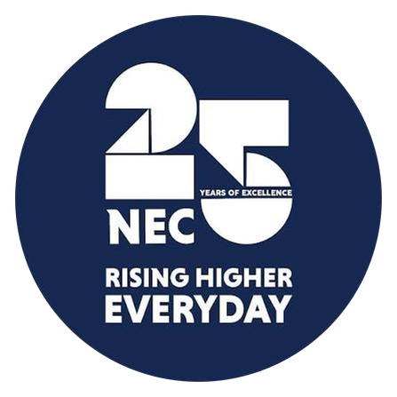

# 🤝 Support & Institutional Help Desk

### Nandha Engineering College (Autonomous) • LeetCode Intelligence Platform
*Accredited by NAAC with 'A+' Grade • Approved by AICTE • Autonomous Institution Affiliated to Anna University*

Welcome to the **Nandha LeetCode Intelligence (NLCI)** Support Resource Hub. We provide multi-tier support for students, faculty mentors, department coordinators, placement directors, and open-source contributors.

---

## 🎯 How Can We Help You Today?

### 1. 🎓 Students & Contest Participants
* **LeetCode Handle Verification:** Ensure your LeetCode profile handle is set to Public in LeetCode Account Settings so telemetry ingestion can read your solved submissions.
* **Sunday Contest Attendance:** Sunday contest telemetry syncs autonomously every Sunday at **08:00 AM, 09:30 AM, and 10:00 PM IST**. Solve at least 1 problem during official contest windows to register verified attendance.
* **Mobile APK Updates:** Download the latest signed Android APK (**v4.5.5, VersionCode 96**) directly from the [Releases Archive](https://github.com/nanthishvaran17/Leetcodeurl-s/tree/main/releases/android).
* **Direct Campus Help:** Visit the CSE Department Computing Lab 4, Nandha Engineering College.

### 2. 👨‍🏫 Faculty Mentors & Department Coordinators (HOD / PLC / STC)
* **Student Allocation:** Use the HOD Command Center or Mentor Matrix to dynamically allocate students across departmental cohorts and batches.
* **Institutional Reports:** Generate 15-Sheet OpenPyXL Excel reports, NAAC/NBA accreditation workbooks, and certified PDF dossiers from the Reports Dashboard.
* **Credentials & Password Resets:** Contact the System Administrator or Head of Department to generate initial credentials with role-based scopes.

### 3. 🛠️ Open-Source Developers & Researchers
* **Bug Reports:** If you discover a functional bug, search existing issues first, then open a detailed [Bug Report](https://github.com/nanthishvaran17/Leetcodeurl-s/issues/new?template=bug_report.yml).
* **Feature Requests:** Submit ideas for new institutional analytics or contest visualization tools via a [Feature Request](https://github.com/nanthishvaran17/Leetcodeurl-s/issues/new?template=feature_request.yml).
* **Security Disclosures:** For vulnerabilities or authentication queries, strictly follow our [Security Policy](https://github.com/nanthishvaran17/Leetcodeurl-s/blob/main/SECURITY.md).

---

## 📞 Institutional Contact Channels

| Channel | Purpose | Contact Details |
| :--- | :--- | :--- |
| **Lead Maintainer** | Technical queries, core engine, architecture | **Nanthish S** — `nanthishvaran17@gmail.com` |
| **HOD - CSE & Cyber Security** | Institutional approvals, academic marks, NAAC data | **Dr. S. Prabhu** — Department of CSE, NEC |
| **Placement Directorate** | Corporate placement rosters & candidate finder | **Prof. M. Santhosh Kumar** — Assistant Professor / CSE(CS) |
| **GitHub Discussions** | Community Q&A, feature discussions, tips | [GitHub Community Discussions](https://github.com/nanthishvaran17/Leetcodeurl-s/discussions) |
| **Live Portal** | Production cloud web interface | [nandha-leetcode.duckdns.org](https://nandha-leetcode.duckdns.org) |

---

## ⏱️ Response Time SLAs
* **Production Outage / Contest Sync Stall:** Investigated within **1 hour** during live contest phases (Sunday 07:45 - 11:00 AM IST).
* **Security Advisories:** Acknowledged in **< 2 hours** (Critical) / **< 6 hours** (High).
* **General Inquiries & PR Reviews:** Answered within **24 to 48 hours**.
